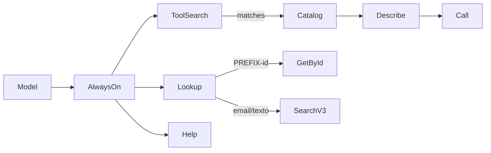

# Billforward MCP Server

[](https://www.npmjs.com/package/billforward-mcp)
[](https://www.npmjs.com/package/billforward-mcp)

This MCP server connects LLMs to [Billforward](https://www.billforward.net/) through a small always-on tool surface: `lookup` resolves prefixed IDs and free-text search, while `search-tools`, `describe-tool`, and `call-api` discover and execute operations from an in-package API catalog—covering the full API without registering hundreds of per-endpoint tools.

<a href="https://ko-fi.com/gregorisoria" target="_blank"></a>



## Configuration

**Primary config:** `BILLFORWARD_ENVIRONMENTS` — a JSON object of named environments (lowercase slugs you choose). Each entry needs `token` and `type` (`sandbox` or `production`); `readonly` defaults to `true` (only JSON `false` enables writes). Optional `baseUrl` overrides the default for that `type`.

```bash
BILLFORWARD_ENVIRONMENTS='{"dev":{"token":"your_dev_token","type":"sandbox","readonly":true},"staging":{"token":"your_staging_token","type":"sandbox","readonly":true},"prod":{"token":"your_production_token","type":"production","readonly":true}}'
```

With one environment configured, tools select it automatically. With two or more, pass the exact name via each tool's `environment` parameter.

Create a local `.env` from the template and keep every environment read-only until writes are explicitly needed:

```bash
cp .env.example .env
```

```dotenv
BILLFORWARD_ENVIRONMENTS='{"dev":{"token":"your_dev_token","type":"sandbox","readonly":true},"staging":{"token":"your_staging_token","type":"sandbox","readonly":true},"prod":{"token":"your_production_token","type":"production","readonly":true}}'
BILLFORWARD_TIMEOUT=15000
```

### MCP client setup

**`.mcp.json`** (loads `.env` from workspace root):

```json
{
  "mcpServers": {
    "billforward": {
      "command": "bash",
      "args": ["-lc", "set -a; source .env; set +a; exec npx -y billforward-mcp"]
    }
  }
}
```

**VS Code / Cursor** (`.vscode/mcp.json`):

```json
{
  "servers": {
    "billforward": {
      "type": "stdio",
      "command": "npx",
      "args": ["-y", "billforward-mcp"],
      "envFile": "${workspaceFolder}/.env"
    }
  }
}
```

**Inline `env`** (when the client does not load env files):

```json
{
  "mcpServers": {
    "billforward": {
      "command": "npx",
      "args": ["-y", "billforward-mcp"],
      "env": {
        "BILLFORWARD_ENVIRONMENTS": "{\"dev\":{\"token\":\"your_dev_token\",\"type\":\"sandbox\",\"readonly\":true},\"staging\":{\"token\":\"your_staging_token\",\"type\":\"sandbox\",\"readonly\":true},\"prod\":{\"token\":\"your_production_token\",\"type\":\"production\",\"readonly\":true}}"
      }
    }
  }
}
```

## How to Get Your API Token

1. Log in to your Billforward environment.
2. Go to **Setup > Personal > API Keys**.
3. Create a token and copy it.

- [Sandbox API Keys](https://app-sandbox.billforward.net/#/setup/personal/api-keys)
- [Production API Keys](https://app.billforward.net/#/setup/personal/api-keys)

## Available Tools

### Discovery (always on)

| Tool | Purpose |
|------|---------|
| `lookup` | Prefixed ID (`ACC-`, `CDT-`, …) → GET by id; email or free text → `/search-v3` |
| `search-tools` | Keyword search over the API catalog → operation names |
| `describe-tool` | Full schema for one catalog entry (method, path, params) |
| `call-api` | Execute a catalog entry by name (writes need a write-enabled environment) |
| `help` | Developer guide and configured environment summary |
| `get-me` | Validate credentials via `/organizations/mine` |

**Typical flow:** `lookup` for IDs and text search → `search-tools` → `describe-tool` → `call-api` for lists and writes.

### Convenience

| Tool | Purpose |
|------|---------|
| `find-accounts` | Paginated account search with metadata filters |
| `get-account-history` | Account-scoped subscriptions and invoices |
| `get-customer-summary` | 360° view: profile, subscriptions, recent invoices, dunning |
| `get-metadata-schema` | Custom metadata keys in use across accounts, subscriptions, invoices |

## Upgrading to 2.0

Version 2.0 replaces per-endpoint tools with discovery-first tools. Ops are unchanged (`npx billforward-mcp` + env tokens).

| Old tool | Replacement |
|----------|-------------|
| `get-account`, `get-subscription`, `get-invoice`, `get-payment`, `get-rate-plan` | `lookup` with the entity ID |
| `get-account-by-email` | `lookup` with the email |
| `search` (local company-name scan) | `lookup` with free text → `/search-v3` |
| dedicated `list-*` tools | `search-tools` → `describe-tool` → `call-api` |

Full changelog: [CHANGELOG.md on GitHub](https://github.com/GregoriSoria/billforward-mcp/blob/main/CHANGELOG.md)

## Security

Named environments default to read-only (`readonly: true`). Only set `"readonly": false` for environments that should allow writes.

When read-only is active, write catalog entries (`create-account`, `update-subscription`, etc.) are blocked with a descriptive error.

## Development

```bash
pnpm run build
pnpm test
```
