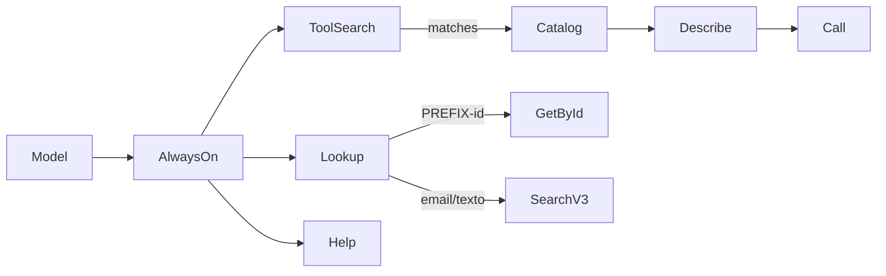

# Progressive API Coverage Implementation Plan

> **For agentic workers:** REQUIRED SUB-SKILL: Use superpowers:subagent-driven-development (recommended) or superpowers:executing-plans to implement this plan task-by-task. Steps use checkbox (`- [ ]`) syntax for tracking.

**Goal:** Ship a tiny always-on MCP surface (`lookup`, `search-tools`, `describe-tool`, `call-api`, `help`) that covers prefixed get-by-id, Billforward `/search-v3`, and the rest of the API via an in-package searchable catalog — then major-bump with an npm-visible upgrade path.

**Architecture:** Keep auth/readonly in `getClient`. Put prefix routing and catalog search in small pure modules under `src/catalog/`. Register five discovery tools; delete dedicated get-by-* tools. Migrate existing `list-*` / writes into the catalog and drop duplicate `registerTool`s. Changelog: full history in root `CHANGELOG.md` (published in the npm tarball); npm page shows only a short README “Upgrading to 2.0” section plus a GitHub link to the full file — do not paste the entire changelog into README.

**Tech Stack:** TypeScript, MCP SDK `registerTool`, Axios, Zod, Vitest, Axios Mock Adapter.

**Spec:** `docs/superpowers/specs/2026-08-11-progressive-api-coverage-design.md`

## Global Constraints

- No new npm dependencies.
- No SFSkills-style bootstrap / SQLite / vector index — catalog is checked-in TS/JSON searched in memory.
- `call-api` executes **named catalog entries only** (no arbitrary paths).
- Prefixed get 404 must **not** fall through to `/search-v3`.
- Writes only through `getClient(environment, { write: true })`; readonly default unchanged.
- Cap list/search records with `MAX_RECORDS_LIMIT` / `DEFAULT_RECORDS_LIMIT`.
- Major version bump to `2.0.0` when removed tools leave `tools/list`.
- Publish `CHANGELOG.md` in the package (`package.json` `files`) and keep README upgrade section short.

## File map

| File | Responsibility |
|------|----------------|
| `src/catalog/prefixes.ts` | Prefix → path map + `resolveGetById(query, resource?)` |
| `src/catalog/entries.ts` | Checked-in catalog array + `getCatalogEntry(name)` |
| `src/catalog/search.ts` | Lexical `searchCatalog(query, limit)` |
| `src/catalog/execute.ts` | `executeCatalogEntry(client, entry, args)` path/query/body fill |
| `src/tools/discovery/lookup.ts` | `lookup` tool (prefix GET or `/search-v3`) |
| `src/tools/discovery/catalog-tools.ts` | `search-tools`, `describe-tool`, `call-api` |
| `src/tools/overview/general.ts` | Rewrite `help` for the new surface |
| `src/index.ts` | Register discovery tools; drop removed registrars as tasks complete |
| `CHANGELOG.md` | Keep a Changelog source of truth (shipped on npm) |
| `README.md` | Short Upgrading section + Absolute GitHub CHANGELOG link |
| `package.json` | `version: 2.0.0`, `files` includes `CHANGELOG.md` |

---

### Task 1: Prefix resolver (pure)

**Files:**
- Create: `src/catalog/prefixes.ts`
- Create: `src/catalog/prefixes.test.ts`

**Interfaces:**
- Produces:
  - `PREFIX_PATHS: Record<string, string>` (keys like `ACC`, values like `/accounts`)
  - `resolveGetById(query: string, resource?: string): { path: string; id: string } | { error: string }`

- [ ] **Step 1: Write the failing tests**

```ts
import { describe, expect, it } from 'vitest';
import { resolveGetById } from './prefixes.js';

describe('resolveGetById', () => {
  it('maps CDT to credit-notes', () => {
    expect(resolveGetById('CDT-61A31A7F-AAAA-BBBB-CCCC-DDDDEEEE')).toEqual({
      path: '/credit-notes/CDT-61A31A7F-AAAA-BBBB-CCCC-DDDDEEEE',
      id: 'CDT-61A31A7F-AAAA-BBBB-CCCC-DDDDEEEE',
    });
  });

  it('maps PAY, REC, ACC, SUB, INV, PRO, PRP, PMD', () => {
    expect(resolveGetById('PAY-1').path).toBe('/payments/PAY-1');
    expect(resolveGetById('REC-1').path).toBe('/receipts/REC-1');
    expect(resolveGetById('ACC-1').path).toBe('/accounts/ACC-1');
    expect(resolveGetById('SUB-1').path).toBe('/subscriptions/SUB-1');
    expect(resolveGetById('INV-1').path).toBe('/invoices/INV-1');
    expect(resolveGetById('PRO-1').path).toBe('/products/PRO-1');
    expect(resolveGetById('PRP-1').path).toBe('/product-rate-plans/PRP-1');
    expect(resolveGetById('PMD-1').path).toBe('/payment-methods/PMD-1');
  });

  it('rejects unknown prefix without resource', () => {
    const result = resolveGetById('ZZZ-1');
    expect(result).toHaveProperty('error');
  });

  it('uses resource override for UUID-only ids', () => {
    expect(resolveGetById('aaaaaaaa-bbbb-cccc-dddd-eeeeeeeeeeee', 'amendments')).toEqual({
      path: '/amendments/aaaaaaaa-bbbb-cccc-dddd-eeeeeeeeeeee',
      id: 'aaaaaaaa-bbbb-cccc-dddd-eeeeeeeeeeee',
    });
  });

  it('does not treat emails as prefixed ids', () => {
    expect(resolveGetById('user@example.com')).toHaveProperty('error');
  });
});
```

- [ ] **Step 2: Run test to verify it fails**

Run: `pnpm test src/catalog/prefixes.test.ts`

Expected: FAIL — module missing.

- [ ] **Step 3: Implement prefix map from the spec table**

```ts
export const PREFIX_PATHS: Record<string, string> = {
  ACC: '/accounts',
  SUB: '/subscriptions',
  INV: '/invoices',
  PAY: '/payments',
  REC: '/receipts',
  CDT: '/credit-notes',
  PRO: '/products',
  PRP: '/product-rate-plans',
  PRF: '/profiles',
  PMD: '/payment-methods',
  COU: '/coupons',
  ORG: '/organizations',
  PER: '/permissions',
  ROL: '/roles',
  PCO: '/pricing-components',
  TAX: '/taxation-strategies',
  UOM: '/units-of-measure',
};

const RESOURCE_PATHS: Record<string, string> = {
  amendments: '/amendments',
  configurations: '/configurations',
  // …all UUID-only resources from the spec “No prefix” list
};

const PREFIXED = /^([A-Z]{2,4})-([A-Z0-9-]+)$/;

export function resolveGetById(query: string, resource?: string) {
  const id = query.trim();
  const match = PREFIXED.exec(id);
  if (match) {
    const prefix = match[1];
    const base = PREFIX_PATHS[prefix];
    if (!base) {
      return { error: `Unknown ID prefix ${prefix}-. Known: ${Object.keys(PREFIX_PATHS).join(', ')}. Pass resource= for UUID-only entities, or use search-tools.` };
    }
    return { path: `${base}/${id}`, id };
  }
  if (resource) {
    const base = RESOURCE_PATHS[resource] ?? PREFIX_PATHS[resource.toUpperCase()] ?? `/${resource}`;
    return { path: `${base}/${id}`, id };
  }
  return { error: 'Not a prefixed Billforward ID. Pass resource= for UUID lookups, or use lookup without resource to call /search-v3.' };
}
```

Use an explicit `RESOURCE_PATHS` map for the UUID-only list in the spec (do not invent unverified resources).

- [ ] **Step 4: Run tests — expect PASS**

Run: `pnpm test src/catalog/prefixes.test.ts`

- [ ] **Step 5: Commit**

```bash
git add src/catalog/prefixes.ts src/catalog/prefixes.test.ts
git commit -m "feat: add Billforward ID prefix resolver"
```

---

### Task 2: Catalog entries + in-memory search

**Files:**
- Create: `src/catalog/entries.ts`
- Create: `src/catalog/search.ts`
- Create: `src/catalog/search.test.ts`

**Interfaces:**
- Produces:
  - `type CatalogEntry = { name: string; summary: string; method: 'GET'|'POST'|'PUT'|'DELETE'; path: string; pathParams?: string[]; queryParams?: string[]; bodyKeys?: string[]; write?: boolean; status?: 'ok'|'unverified' }`
  - `CATALOG: CatalogEntry[]`
  - `getCatalogEntry(name: string): CatalogEntry | undefined`
  - `searchCatalog(query: string, limit?: number): CatalogEntry[]`

- [ ] **Step 1: Write the failing tests**

```ts
import { describe, expect, it } from 'vitest';
import { getCatalogEntry, searchCatalog } from './search.js';
// re-export getCatalogEntry from entries via search or import from entries

it('finds credit-notes list by keyword', () => {
  const hits = searchCatalog('credit note', 5);
  expect(hits.some((e) => e.name === 'list-credit-notes')).toBe(true);
});

it('getCatalogEntry returns list-credit-notes', () => {
  expect(getCatalogEntry('list-credit-notes')).toMatchObject({
    method: 'GET',
    path: '/credit-notes',
    write: false,
  });
});
```

- [ ] **Step 2: Run — expect FAIL**

Run: `pnpm test src/catalog/search.test.ts`

- [ ] **Step 3: Seed a minimal catalog + lexical search**

`entries.ts` must include at least:

- All current list GETs: accounts, profiles, subscriptions, invoices, payments, receipts, products, product-rate-plans
- Credit notes: `list-credit-notes` (`GET /credit-notes`), `list-credit-notes-by-account` (`GET /credit-notes/account/{accountId}`), `list-credit-notes-by-invoice`, `list-credit-notes-by-subscription`
- Refunds list if path known (`GET /refunds`) marked `status: 'unverified'` until probed in a later task — or omit until Task 6
- Existing write ops as `write: true`: create-account, update-account, create-subscription, cancel-subscription (if it hits API), issue-invoice, create-charge

Path templates use `{paramName}` matching `pathParams`.

`search.ts`:

```ts
export function searchCatalog(query: string, limit = 10): CatalogEntry[] {
  const tokens = query.toLowerCase().split(/[^a-z0-9]+/).filter(Boolean);
  const scored = CATALOG.map((entry) => {
    const hay = `${entry.name} ${entry.summary} ${entry.path} ${entry.method}`.toLowerCase();
    const score = tokens.reduce((s, t) => s + (hay.includes(t) ? 1 : 0), 0);
    return { entry, score };
  }).filter((x) => x.score > 0);
  scored.sort((a, b) => b.score - a.score || a.entry.name.localeCompare(b.entry.name));
  return scored.slice(0, limit).map((x) => x.entry);
}

export function getCatalogEntry(name: string) {
  return CATALOG.find((e) => e.name === name);
}
```

- [ ] **Step 4: Run — expect PASS**

- [ ] **Step 5: Commit**

```bash
git add src/catalog/entries.ts src/catalog/search.ts src/catalog/search.test.ts
git commit -m "feat: add searchable Billforward API catalog"
```

---

### Task 3: Catalog executor

**Files:**
- Create: `src/catalog/execute.ts`
- Create: `src/catalog/execute.test.ts`

**Interfaces:**
- Consumes: `CatalogEntry`, AxiosInstance
- Produces: `executeCatalogEntry(client, entry, args: Record<string, unknown>): Promise<unknown>`

- [ ] **Step 1: Write the failing tests** (axios-mock-adapter)

```ts
it('fills path params and query for GET', async () => {
  mock.onGet('/credit-notes/account/ACC-1').reply((config) => {
    expect(config.params).toMatchObject({ records: 5 });
    return [200, { results: [] }];
  });
  const entry = {
    name: 'list-credit-notes-by-account',
    summary: 'x',
    method: 'GET' as const,
    path: '/credit-notes/account/{accountId}',
    pathParams: ['accountId'],
    queryParams: ['records', 'offset'],
  };
  await executeCatalogEntry(client, entry, { accountId: 'ACC-1', records: 5 });
});

it('POSTs body keys for write entries', async () => {
  mock.onPost('/charges').reply((config) => {
    expect(JSON.parse(config.data)).toMatchObject({ accountId: 'ACC-1', amount: 10 });
    return [200, { results: [] }];
  });
  await executeCatalogEntry(client, {
    name: 'create-charge', summary: 'x', method: 'POST', path: '/charges',
    bodyKeys: ['accountId', 'name', 'amount', 'currency'], write: true,
  }, { accountId: 'ACC-1', name: 'fee', amount: 10, currency: 'USD' });
});
```

- [ ] **Step 2: Run — expect FAIL**

- [ ] **Step 3: Implement**

```ts
export async function executeCatalogEntry(client, entry, args) {
  let path = entry.path;
  for (const key of entry.pathParams ?? []) {
    const value = args[key];
    if (value == null || value === '') throw new Error(`Missing path param ${key}`);
    path = path.replace(`{${key}}`, encodeURIComponent(String(value)));
  }
  if (path.includes('{')) throw new Error(`Unresolved path params in ${path}`);
  const params = Object.fromEntries(
    (entry.queryParams ?? []).filter((k) => args[k] !== undefined).map((k) => [k, args[k]]),
  );
  const body = entry.method === 'GET' || entry.method === 'DELETE'
    ? undefined
    : Object.fromEntries((entry.bodyKeys ?? []).filter((k) => args[k] !== undefined).map((k) => [k, args[k]]));
  const response = await client.request({ method: entry.method, url: path, params, data: body });
  return response.data;
}
```

- [ ] **Step 4: Run — expect PASS**

- [ ] **Step 5: Commit**

```bash
git add src/catalog/execute.ts src/catalog/execute.test.ts
git commit -m "feat: execute catalog entries against Billforward"
```

---

### Task 4: `lookup` tool (replace get-by-* and old search)

**Files:**
- Create: `src/tools/discovery/lookup.ts`
- Create: `src/tools/discovery/lookup.test.ts`
- Modify: `src/index.ts` — register `registerLookupTools`
- Modify: `src/tools/customers/accounts.ts` — remove `get-account`, `get-account-by-email`
- Modify: `src/tools/customers/subscriptions.ts` — remove `get-subscription`
- Modify: `src/tools/customers/invoices.ts` — remove `get-invoice`
- Modify: `src/tools/customers/payments.ts` — remove `get-payment`
- Modify: `src/tools/pricing/plans.ts` — remove `get-rate-plan`
- Modify: `src/tools/search/unified.ts` — remove or gut old `search` registration (delete file if unused)
- Modify tests that call removed tools (`src/index.test.ts`, `src/tools/search/unified.test.ts`, etc.)

**Interfaces:**
- Consumes: `resolveGetById`, `getClient`, `environmentParam`, `readResource` (optional)
- Produces MCP tool `lookup`

- [ ] **Step 1: Write failing lookup tests**

```ts
it('GETs /credit-notes/{id} for CDT prefix', async () => {
  mock.onGet('/credit-notes/CDT-1').reply(200, { results: [{ id: 'CDT-1' }] });
  const out = JSON.parse((await handler({ query: 'CDT-1' })).content[0].text);
  expect(out).toMatchObject({ mode: 'get-by-id', path: '/credit-notes/CDT-1' });
  expect(mock.history.get[0].url).toContain('/credit-notes/CDT-1');
});

it('uses /search-v3 for email', async () => {
  mock.onGet('/search-v3').reply(200, { groupedResults: { account: [] } });
  await handler({ query: 'a@b.com', limit: 5 });
  expect(mock.history.get[0].url).toContain('/search-v3');
  expect(mock.history.get[0].params).toMatchObject({ query: 'a@b.com' });
});

it('does not fall through to search-v3 on get-by-id 404', async () => {
  mock.onGet('/credit-notes/CDT-missing').reply(404, { errorMessage: 'not found' });
  const result = await handler({ query: 'CDT-missing' });
  expect(result.isError).toBe(true);
  expect(mock.history.get.map((r) => r.url).join(',')).not.toContain('search-v3');
});
```

- [ ] **Step 2: Run — expect FAIL**

Run: `pnpm test src/tools/discovery/lookup.test.ts`

- [ ] **Step 3: Implement `lookup` and wire registration; delete old get tools**

```ts
server.registerTool('lookup', {
  description: 'Resolve a Billforward prefixed ID via GET /{resource}/{id}, or search with GET /search-v3?query= for email/free text. Pass resource= for UUID-only entities.',
  inputSchema: {
    ...environmentParam,
    query: z.string().min(1),
    resource: z.string().optional(),
    limit: z.number().int().positive().optional().default(DEFAULT_RECORDS_LIMIT),
    offset: z.number().int().nonnegative().optional().default(0),
  },
}, async ({ environment, query, resource, limit, offset }) => {
  const client = getClient(environment);
  const looksPrefixed = /^[A-Z]{2,4}-[A-Z0-9-]+$/.test(query.trim());
  if (looksPrefixed || resource) {
    const resolved = resolveGetById(query, resource);
    if ('error' in resolved) return { isError: true, content: [{ type: 'text', text: resolved.error }] };
    try {
      const response = await client.get(resolved.path);
      return { content: [{ type: 'text', text: JSON.stringify({ mode: 'get-by-id', path: resolved.path, data: response.data }, null, 2) }] };
    } catch (error: any) {
      return { isError: true, content: [{ type: 'text', text: `Error GET ${resolved.path}: ${error.message}` }] };
    }
  }
  try {
    const safeLimit = Math.min(limit, MAX_RECORDS_LIMIT);
    const response = await client.get('/search-v3', { params: { query, records: safeLimit, offset } });
    return { content: [{ type: 'text', text: JSON.stringify({ mode: 'search-v3', data: response.data }, null, 2) }] };
  } catch (error: any) {
    return { isError: true, content: [{ type: 'text', text: `Error search-v3: ${error.message}` }] };
  }
});
```

Decision rule: if `query` matches prefixed pattern **or** `resource` is set → get-by-id path; else search-v3. Do not call `/accounts/email/…`.

Update `src/index.ts` imports. Fix/remove tests that targeted deleted tools.

- [ ] **Step 4: Run focused + broader tests**

Run: `pnpm test src/tools/discovery/lookup.test.ts src/index.test.ts src/tools/search/unified.test.ts`

Expected: PASS (adjust/remove obsolete cases).

- [ ] **Step 5: Commit**

```bash
git add src/tools/discovery src/index.ts src/tools/customers src/tools/pricing src/tools/search src/index.test.ts
git commit -m "feat: add lookup; remove dedicated get-by-id tools"
```

---

### Task 5: `search-tools`, `describe-tool`, `call-api`

**Files:**
- Create: `src/tools/discovery/catalog-tools.ts`
- Create: `src/tools/discovery/catalog-tools.test.ts`
- Modify: `src/index.ts`
- Modify: `src/tools/overview/general.ts` — rewrite `help` text to the five-tool model

**Interfaces:**
- Consumes: `searchCatalog`, `getCatalogEntry`, `executeCatalogEntry`, `getClient`, `environmentParam`
- Produces tools: `search-tools`, `describe-tool`, `call-api`

- [ ] **Step 1: Write failing tests**

```ts
it('search-tools returns credit-notes matches', async () => {
  const text = (await searchHandler({ query: 'credit notes' })).content[0].text;
  expect(text).toContain('list-credit-notes');
});

it('describe-tool returns full entry', async () => {
  const text = (await describeHandler({ name: 'list-credit-notes' })).content[0].text;
  expect(JSON.parse(text).path).toBe('/credit-notes');
});

it('call-api blocks writes when env is readonly', async () => {
  // configure readonly env in test the same way billforward.test.ts does
  const result = await callHandler({ name: 'create-charge', args: { accountId: 'ACC-1', amount: 1 } });
  expect(result.isError).toBe(true);
});

it('call-api GETs a catalog entry', async () => {
  mock.onGet('/credit-notes').reply(200, { results: [{ id: 'CDT-1' }] });
  const result = await callHandler({ name: 'list-credit-notes', args: { records: 1 } });
  expect(result.isError).not.toBe(true);
});
```

- [ ] **Step 2: Run — expect FAIL**

- [ ] **Step 3: Implement the three tools**

`call-api` inputSchema:

```ts
{
  ...environmentParam,
  name: z.string().describe('Exact catalog entry name from search-tools / describe-tool'),
  args: z.record(z.string(), z.unknown()).optional().default({}),
}
```

Handler:

```ts
const entry = getCatalogEntry(name);
if (!entry) return { isError: true, content: [{ type: 'text', text: `Unknown catalog entry: ${name}` }] };
const client = getClient(environment, entry.write ? { write: true } : {});
const data = await executeCatalogEntry(client, entry, args);
return { content: [{ type: 'text', text: JSON.stringify(data, null, 2) }] };
```

`search-tools` returns `{ matches: [{ name, summary, method, path }] }` only (no full schemas).

Rewrite `help` to document: `lookup`, `search-tools`, `describe-tool`, `call-api`, plus any temporary leftover list tools still registered.

- [ ] **Step 4: Run — expect PASS**

- [ ] **Step 5: Commit**

```bash
git add src/tools/discovery/catalog-tools.ts src/tools/discovery/catalog-tools.test.ts src/index.ts src/tools/overview/general.ts
git commit -m "feat: add catalog search, describe, and call-api tools"
```

---

### Task 6: Move remaining list/write tools into catalog; delete duplicate MCP tools

**Files:**
- Modify: `src/catalog/entries.ts` — ensure every remaining dedicated tool has a catalog twin
- Modify: `src/tools/customers/*.ts`, `src/tools/pricing/plans.ts`, `src/tools/insights/customer360.ts` — remove `list-*` / write `registerTool`s that are now catalog-only **or** keep insights as always-on if still valuable
- Modify: `src/index.ts` — stop importing removed registrars
- Update tests accordingly

**Decision (locked):** After this task, always-on MCP tools are only:

- `lookup`, `search-tools`, `describe-tool`, `call-api`, `help`, `get-me`
- Keep `get-account-history`, `find-accounts`, `get-customer-summary`, `get-metadata-schema` as always-on **convenience** tools until a follow-up removes them (spec allows temporary leftovers). Do **not** keep `list-accounts` / `list-payments` / etc. once catalog covers them.

- [ ] **Step 1: Expand catalog entries for every former list/write tool; add tests that `searchCatalog('list payments')` hits `list-payments`**

- [ ] **Step 2: Run catalog search tests — PASS**

- [ ] **Step 3: Delete the dedicated list/write registrations and fix `src/index.test.ts` to assert catalog/`call-api` instead of raw list tool names where needed**

- [ ] **Step 4: Full test suite**

Run: `pnpm test`

Expected: PASS

- [ ] **Step 5: Commit**

```bash
git add src/catalog src/tools src/index.ts src/index.test.ts
git commit -m "refactor: route list and write ops through API catalog"
```

---

### Task 7: Docs, npm packaging, major bump

**Files:**
- Create: `CHANGELOG.md`
- Modify: `README.md` — replace Available Tools with new surface; add short Upgrading section
- Modify: `package.json` — `"version": "2.0.0"`, `"files": ["build", "CHANGELOG.md"]`
- Modify: `docs/superpowers/specs/2026-08-11-progressive-api-coverage-design.md` — note npm changelog layout if not already accurate

**Changelog / npm layout (locked):**

| Artifact | Role on npm |
|----------|-------------|
| `README.md` | Rendered on the package page. Include a **short** `## Upgrading to 2.0` with the migration table + link to full changelog on GitHub: `https://github.com/GregoriSoria/billforward-mcp/blob/main/CHANGELOG.md` |
| `CHANGELOG.md` | Full Keep a Changelog history. Included in the published tarball via `files`, but **not** inlined into README (avoids a wall of history on the npm page). |

- [ ] **Step 1: Write `CHANGELOG.md`**

```markdown
# Changelog

All notable changes to this project are documented in this file.

The format is based on [Keep a Changelog](https://keepachangelog.com/en/1.1.0/),
and this project adheres to [Semantic Versioning](https://semver.org/spec/v2.0.0.html).

## [2.0.0] - YYYY-MM-DD

### Added
- `lookup` — prefixed get-by-id or `/search-v3` free-text/email search
- `search-tools`, `describe-tool`, `call-api` — progressive discovery over the in-package API catalog
- Credit-note and other previously missing read operations via the catalog

### Changed
- MCP tool surface is discovery-first (~5 core tools) instead of one tool per endpoint

### Removed
- `get-account`, `get-account-by-email`, `get-subscription`, `get-invoice`, `get-payment`, `get-rate-plan`
- Legacy `search` local company-name scan and `/accounts/email/…` path
- Dedicated `list-*` MCP tools (use catalog + `call-api`)

### Migration
| Old | New |
|-----|-----|
| `get-account` / `get-invoice` / … | `lookup` with the ID |
| `get-account-by-email` | `lookup` with the email |
| `search` | `lookup` (search-v3) |
| `list-payments` etc. | `search-tools` → `call-api` |

## [1.3.0] - …

(Summarize prior release from git history in one short section, or start history at 2.0.0 and note “earlier versions undocumented here”.)
```

- [ ] **Step 2: Rewrite README (cleanup + diagram)**

Requirements for `README.md` (npm-visible):

1. Open with a direct one-paragraph explanation of what the MCP does (no
   marketing fluff). Remove the Features section entirely.
2. Put the architecture mermaid diagram near the top (right after the
   intro / badges) so readers see how discovery works:



3. Highlight `BILLFORWARD_ENVIRONMENTS` as the primary config — show the
   full JSON example prominently; keep MCP client snippets secondary.
4. Remove the Advanced Environment Variables section and its table.
5. Rewrite Available Tools for the new surface (`lookup`, `search-tools`,
   `describe-tool`, `call-api`, `help`, plus remaining convenience tools).
6. Add short `## Upgrading to 2.0` with the migration table + GitHub
   CHANGELOG link (do not paste the full changelog into README).

- [ ] **Step 3: Bump `package.json` to `2.0.0` and ensure `files` packs `CHANGELOG.md`**

- [ ] **Step 4: Run full tests + build**

Run: `pnpm test && pnpm run build`

Expected: PASS

- [ ] **Step 5: Commit**

```bash
git add CHANGELOG.md README.md package.json docs/superpowers/specs/2026-08-11-progressive-api-coverage-design.md
git commit -m "docs: add 2.0 changelog and npm upgrade notes"
```

Do **not** `npm publish` in this plan unless the user explicitly asks.

---

## Spec coverage checklist

| Spec requirement | Task |
|------------------|------|
| Prefix get-by-id map | 1, 4 |
| `/search-v3` for non-ID | 4 |
| No fallthrough on 404 | 4 |
| Catalog + search/describe/call | 2, 3, 5 |
| call-api catalog-only | 3, 5 |
| Remove get-by-* / old search | 4 |
| Migrate list/writes; shrink tools/list | 6 |
| Readonly writes | 5 |
| CHANGELOG + README upgrade + major bump | 7 |
| No vector index / bootstrap | Global + Task 2 |

## Placeholder / consistency self-review

- Tool names fixed: `lookup`, `search-tools`, `describe-tool`, `call-api`, `help`, `get-me`.
- `resolveGetById` / `searchCatalog` / `getCatalogEntry` / `executeCatalogEntry` names consistent across tasks.
- npm: full changelog in `CHANGELOG.md`; README only short upgrade blurb + GitHub link.
